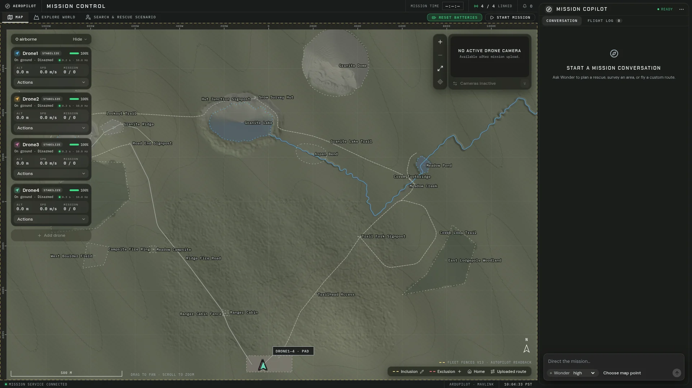
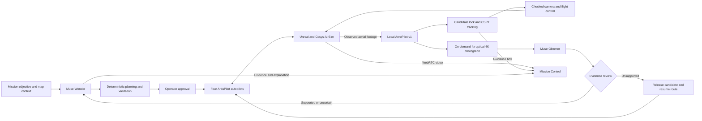

# AeroPilot

**[live demo here](https://alotel.app)**

**AI native mission control for autonomous drone fleets.**

AeroPilot lets operators plan, coordinate and monitor drone missions using natural language. It combines Meta's reasoning and perception models with deterministic mission planning, real autopilot software and a simulated physical world. An operator describes an objective; AeroPilot turns it into checked flight plans, coordinates the aircraft and interprets the visual evidence they collect.

The platform brings mission planning, fleet telemetry, live video, target tracking and evidence review into one workspace. Meta Muse Wonder acts as the mission commander, our local SAM 3.1 fine-tune detects potential targets, and Muse Glimmer evaluates the evidence. The current release operates one to four simulated aircraft and includes search and rescue as its most complete demonstration of this workflow.

Built for **Push the Frontier** at the Meta Global AI Developer Hackathon, October 27–November 4, 2026.

[Step-by-step setup](deploy/README.md#step-by-step-setup) · [AeroPilot-v1 model](https://huggingface.co/AeroPilot/AeroPilot-v1) · [Checks](https://github.com/brookaylneh/AeroPilot/actions)



## The problem

Drones have made aerial operations more accessible, but managing a fleet still requires substantial operator effort. Each aircraft needs a safe route. Search areas and flight paths need coordination. Batteries, terrain and restricted airspace constrain the plan. Every camera produces footage that someone must interpret, and new observations can change the mission.

AeroPilot connects these responsibilities in a mission workflow: understand the objective, generate and check a plan, coordinate execution, evaluate observations and adapt. The operator can focus on the mission while retaining visibility and control over the aircraft and decisions.

## What AeroPilot can do

| Capability                            | How it works                                                                                                                                                                                    |
| ------------------------------------- | ----------------------------------------------------------------------------------------------------------------------------------------------------------------------------------------------- |
| **Natural-language mission planning** | Describe an objective using named landmarks or operator-selected map locations. Wonder calls planning tools that return concrete routes, settings, durations and battery requirements.          |
| **Fleet coordination**                | Assign work across the available aircraft, generate search sectors and coverage lanes, and use departure lanes and altitude layers to maintain separation. The current fleet has four drones.   |
| **Search, survey and inspection**     | Supported planning tasks include area and datum searches, route surveys along mapped roads or trails, boundary checks, point-inspection orbits, transit and waypoint routes.                    |
| **Live perception and tracking**      | Give the system a visible target description. SAM detects candidates in observed flight segments; a visual tracker maintains the guidance box and drives checked camera and aircraft following. |
| **Evidence analysis**                 | A separate optical camera captures an original close-up image. Glimmer compares visible evidence with the mission description and sends assessments to Wonder.                                  |
| **No-fly zones**                      | Draw and save exclusion polygons on the map while the fleet is landed. Future plans are checked against the saved boundaries; routes that cross them are rejected with a reason.                |
| **Operator supervision**              | Review plans before launch, monitor the shared map and live video, inspect evidence and flight logs, and issue hold, land or return-home commands.                                              |

## How a mission runs

1. **Describe the objective.** Provide a destination, area, route or inspection target. For detection tasks, include what to look for and any visible distinguishing features.
2. **Generate and validate the plan.** Wonder selects the task and calls the mission planner. Code generates the geometry and checks terrain clearance, obstacles, flight fences, aircraft separation and battery feasibility.
3. **Review and launch.** The map shows the proposed routes. The approval card lists each aircraft's steps, duration and battery use. Flight begins after operator approval.
4. **Observe and investigate.** During observed steps, SAM processes aerial footage. A candidate can trigger a lock, visual tracking and a separate evidence capture while other aircraft continue their assignments.
5. **Assess the evidence.** Glimmer reviews the image against the requested description. Clear negatives can release the candidate so the drone resumes its route; other assessments, imagery and location information reach Wonder for further review.
6. **Adapt and complete.** Wonder reconciles observations with mission progress and can propose further investigation or search expansion. Changed routes pass through the planner's checks; new launches and search expansions require approval. Operators retain the controls to hold or return the fleet.

## What the models do

| Model                                | Role                                                                                                                                           | Runtime                                                                |
| ------------------------------------ | ---------------------------------------------------------------------------------------------------------------------------------------------- | ---------------------------------------------------------------------- |
| **Muse Wonder**                      | Interprets mission objectives, calls planning and control tools, coordinates aircraft, reviews evidence and explains decisions                 | Meta Model API                                                         |
| **AeroPilot-v1, fine-tuned SAM 3.1** | Open-vocabulary detection, segmentation and persistent tracking, with independent state for four drone cameras                                 | One local Docker device service; official SAM Object Multiplex tracker |
| **Muse Glimmer 30B**                 | Evaluates an original 4K, 4× optical-camera photograph against the requested visual description and reports supporting or conflicting evidence | Official Q4_K_M model and projector, llama.cpp on a Modal H200         |

The local detector is [AeroPilot-v1](https://huggingface.co/AeroPilot/AeroPilot-v1), not the base checkpoint. Its text encoder remains frozen; the aerial detector was fine-tuned while the original video-tracking and mask-head tensors were preserved. The serving package verifies the published checkpoint SHA-256 at startup. Training and dataset evaluation were performed separately; this repository contains the serving, integration and qualification code, not the training datasets or training harness.

A separate Modal SAM image endpoint supports calibration. The live tracking pipeline uses the local device service.

Per-drone detection and evidence-review contexts share the model services. They are not separate copies of the model for each aircraft. Wonder orchestrates the workflow through tools; the mission service owns flight execution and enforces the checks.

## System architecture

The browser is the operator workspace. The mission service manages planning, telemetry, execution and inspection state. ArduPilot SITL runs the aircraft autopilots, while Cosys-AirSim and Unreal Engine provide the physical simulation, cameras and environment. Model services provide mission reasoning, detection and evidence analysis.



## Try the demo

1. Open the [live demo](https://alotel.app) in a desktop browser. **Map**, **Explore world** and **Search & rescue scenario** share one workspace.
2. Start with a mission in the Map conversation. Specify the aircraft, objective and named destination or area. You can ask for a preview without launching.
3. Inspect the generated routes and per-drone plan details, then approve when ready to fly.
4. Follow the aircraft on the map, open a drone's video, and inspect observations in the evidence cards and flight log.
5. Ask Wonder to return the aircraft home when finished. End the mission after landing before creating another scenario.

Example mission requests:

> Use Drone1 to inspect Ranger Cabin with one orbit at 40 m above ground, a 30 m stand-off and 3 m/s, then return home. Present the checked plan for approval.

> Preview only: use all four drones for a route survey along Meadow Creek at 40 m above ground and 5 m/s, with 15 m/s transit and individual returns home. Check terrain, no-fly zones, separation and batteries. Do not launch.

The public demo is a shared simulation: visitors see the same conversation, aircraft and evidence. One browser at a time controls live video and Studio; another browser can still use the map and Mission Control. Coordinate before changing an active mission.

### Search and rescue: an end-to-end example

The scenario creator demonstrates how the general mission workflow handles an evolving, evidence-driven task:

1. In **Search & rescue scenario**, select a character, define their situation and place them in the simulated world.
2. Generate a missing-person report. **Easy** uses one aircraft and a small reported area described relative to a landmark; **Medium** uses two aircraft; **Hard** provides broader clues that require search planning.
3. Select **Launch mission brief**, review the prompt placed in the conversation, then send it. Launching the brief alone does not issue a flight command.
4. Wonder uses the report, public map and available fleet to request a checked search plan. Review and approve it.
5. SAM detects potential targets in live footage. The tracker follows a candidate, the separate camera takes a close-up photograph, and Glimmer compares visible characteristics against the report.
6. Wonder reviews promising or uncertain sightings, keeps the operator informed and can propose expanding the search when no credible lead is found. The operator remains responsible for confirming identity.

Broader searches use **Lost Person Behavior–informed planning**, including published ISRID distance and dispersion tables for supported subject categories. These are empirical planning inputs, not a claim of certification against an international standard. The sources and assumptions are recorded in the [region planner](mission_planner/gcs/region.py). Explicit reported polygons are searched as specified rather than being replaced with a probability-derived region.

Detection and completion time vary with placement, visibility and the plan. An unsuccessful pass means the target was not detected in those views; it does not prove the area is empty.

## Applications and direction

The mission primitives are intended to support several kinds of aerial work:

| Application                                   | Relevant platform capabilities                                                                        |
| --------------------------------------------- | ----------------------------------------------------------------------------------------------------- |
| **Infrastructure and powerline inspection**   | Route following, boundary checks, stand-off inspection and visual evidence review.                    |
| **Surveying and mapping**                     | Coverage planning, coordinated flight paths and imagery collection for downstream mapping tools.      |
| **Wildlife conservation**                     | Prompt-driven object detection, visual tracking and location-tagged observations.                     |
| **Environmental and agricultural monitoring** | Area and corridor surveys with evidence collected against a stated objective.                         |
| **Disaster assessment**                       | Fleet tasking, restricted-area enforcement and visual investigation of reported locations.            |
| **Search and rescue**                         | Report-driven search regions, candidate investigation, evidence review and proposed search expansion. |

Search and rescue is the integrated scenario demonstrated in this release. The other applications describe uses of the existing planning and perception primitives; domain-specific analytics, datasets and field validation remain additional work. The current deployment supports four simulated aircraft, not an unlimited fleet or a field-qualified hardware product.

Our goal is to make fleet operations accessible through conversation, with operators focused on mission outcomes and AI assisting with coordination, observation and adaptation.

## Engineering and hackathon contributions

The mission and perception stack below was built during the October 27–November 4, 2026 hackathon, on top of an existing Scenario Studio source baseline:

- **A mission planner with explicit execution checks.** Wonder selects tasks; code generates versioned routes and checks terrain, obstacles, fences, aircraft separation and battery limits before operator approval. Changes to a plan require a new checked version.
- **Four real autopilot processes in a simulated world.** ArduPilot SITL communicates over MAVLink and exchanges sensor and motor data with Cosys-AirSim. Aircraft motion is produced by that control loop.
- **A local, stateful SAM video adapter.** Incoming decoded frames retain per-drone tracking memory. Source-frame hashes, timestamps, coordinate checks and mandatory masks connect detections to their evidence. Compile warmup and bounded GPU memory are part of the device package.
- **Detection, visual tracking and evidence review working together.** CSRT follows the detected subject for the video overlay and camera guidance. A separate on-demand 4× optical camera captures one original 4K photograph per detected object, without digitally enlarging the search image. Unsupported candidates are released so the checked search can continue.
- **A shared mission-control workspace.** Natural-language tasking, map and fence tools, plan approval, live video, evidence cards and flight logs let operators inspect the complete mission. World exploration and a saved scenario creator provide a repeatable environment for demonstrations.

Meta's models, Unreal Engine, ArduPilot, Cosys-AirSim, OpenCV and third-party artwork are upstream dependencies. We claim the application, model adaptation and integrations described above, not authorship of those dependencies.

The [audited development history](https://github.com/brookaylneh/AeroPilot/tree/hackathon-development) preserves original dates. [Compare the baseline and submission](https://github.com/brookaylneh/AeroPilot/compare/hackathon-baseline...hackathon-submission) to review the work built during the hackathon.

## Measured results and limits

The [device qualification record](mission_planner/measurements/aeropilot-v1.json) reports the published checkpoint on an **NVIDIA RTX PRO 6000 Blackwell Server Edition**, with FP32 weights, BF16 autocast, TF32 and `torch.compile`:

| Recorded test                            | Result                                                                    |
| ---------------------------------------- | ------------------------------------------------------------------------- |
| Four-session packaged replay, 960 frames | **17.60 aggregate FPS** median across three passes                        |
| Request latency in that replay           | **224 ms median; 241 ms p95**                                             |
| Peak process GPU memory                  | **7.96 GB**, under a 16-billion-byte software budget                      |
| Persistent-session soak                  | **36,004 frames over 2,026.74 seconds**; 27,002 detection masks validated |

These are recorded-frame service measurements, not live search recall, browser FPS or a benchmark on a physical 16 GB GPU. The earlier base-model replay measured 20.16 aggregate FPS. The fine-tuned detector trades some of that throughput for improved aerial recognition.

The separate [model-card evaluation](https://huggingface.co/AeroPilot/AeroPilot-v1#results) reports HERIDAL recall increasing from **65.0% to 87.5%** on whole images, and from **79.5% to 91.7%** with 2×2 tiling. Those dataset scores were not reproduced in this repository's live simulation acceptance. The current live service processes whole frames; the tiled result is not its operating mode.

Small or occluded people can still be missed; trees and other scenery can produce false candidates. Neither a SAM detection nor a Glimmer review establishes identity. The live guidance box and sampled evidence image have different timing. Real aircraft would additionally require calibrated sensors, a hardware gimbal adapter, communications-loss testing and flight qualification.

## Run the code checks

A Linux checkout with **Node 22 (22.12 or newer, below 23)**, **Python 3.10** and **ripgrep (`rg`)** on `PATH` can run the source checks without credentials, a GPU, Unreal or paid model calls:

```sh
# Ubuntu prerequisite; install ripgrep with your OS package manager elsewhere.
sudo apt-get install --yes --no-install-recommends ripgrep

git clone https://github.com/brookaylneh/AeroPilot.git
cd AeroPilot
npm ci
python3.10 -m venv .venv-cosys
.venv-cosys/bin/python -m pip install -r requirements.txt

# Generate test receipts and terrain masks once in a fresh checkout.
.venv-cosys/bin/python -m world.unreal.valley \
  --evidence-dir .local/evidence/ci-terrain

npm test
npm run typecheck
npm run format:check
.venv-cosys/bin/ruff check
.venv-cosys/bin/ruff format --check
.venv-cosys/bin/python -m unittest
```

The terrain generator refuses to overwrite an existing output directory; run it once per fresh checkout. Tests requiring missing vendor assets report skips. CI runs these checks and a secret scan on GitHub.

For the **full running simulation**, follow the [numbered setup guide](deploy/README.md#step-by-step-setup). It requires an NVIDIA simulation host, Docker, Epic-authorized Unreal Engine/content, the SAM checkpoint and warmup fixture, Meta API access, and a configured Glimmer endpoint. The licensed world assets, model weights, warmup images and deployment credentials are not bundled. `npm run dev` alone does not start the simulator or model services.

## Code map

| Path                                                                            | What to review                                                                           |
| ------------------------------------------------------------------------------- | ---------------------------------------------------------------------------------------- |
| [scenario_creator/](scenario_creator/README.md)                                 | Scenario UI, subject descriptions and rescue briefings                                   |
| [mission_planner/gcs/](mission_planner/gcs/README.md)                           | Plan generation and validation, MAVLink execution, candidate lock, tracking and evidence |
| [mission_planner/agents/](mission_planner/agents/README.md)                     | Wonder tools, model clients and Glimmer review contracts                                 |
| [mission_planner/agents/services/](mission_planner/agents/services/README.md)   | Local SAM device package and Modal services                                              |
| [world/](world/README.md)                                                       | Unreal world, Cosys integration, terrain and asset manifests                             |
| [web/](web/README.md)                                                           | Browser shell, shared-session broker, video and evidence access                          |
| [deploy/](deploy/README.md)                                                     | Setup, pinned toolchains, systemd units and operations                                   |
| [mission_planner/measurements/](mission_planner/measurements/aeropilot-v1.json) | Logged qualification and acceptance summaries, with their scope and limitations          |

## License and attribution

Original AeroPilot application code is licensed under [Apache-2.0](LICENSE). Third-party notices and the exceptions for upstream patches are in [NOTICE](NOTICE); asset terms are in [the asset inventory](world/unreal/assets.md). AeroPilot-v1 weights use the separate [SAM License](https://huggingface.co/AeroPilot/AeroPilot-v1/blob/main/LICENSE). The repository does not redistribute Unreal Engine, model weights, training datasets or licensed world assets.

See [CONTRIBUTING.md](CONTRIBUTING.md) for development rules and [SECURITY.md](SECURITY.md) for private vulnerability reporting.
