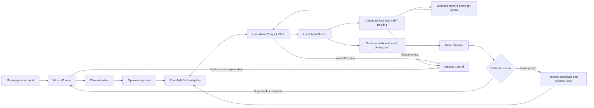

# AeroPilot

**[live demo here](https://alotel.app)**

**An AI mission commander for drone search and rescue.**

AeroPilot turns a missing-person report into an operator-approved search by up to four simulated drones. Meta Muse Wonder coordinates the mission, a local SAM 3.1 fine-tune detects and tracks candidates, and Muse Glimmer reviews close-up evidence before a sighting reaches the operator.

Built for **Push the Frontier** at the Meta Global AI Developer Hackathon, October 27–November 4, 2026. The goal is to reduce the work of coordinating aircraft, searching video and checking sightings during a rescue. This release demonstrates that workflow in simulation; it is not a field-qualified rescue system.

[Step-by-step setup](deploy/README.md#step-by-step-setup) · [AeroPilot-v1 model](https://huggingface.co/AeroPilot/AeroPilot-v1) · [Checks](https://github.com/brookaylneh/AeroPilot/actions)


## Try the demo

1. Open the [live demo](https://alotel.app) in a desktop browser. **Map**, **Explore world** and **Search & rescue scenario** share one workspace.
2. In **Search & rescue scenario**, choose a character, place them in the world, and generate an **Easy** missing-person report. Easy uses one aircraft and a small search area described relative to a landmark. Medium uses two aircraft; Hard needs broader planning.
3. Select **Launch mission brief**, review the prompt placed in the conversation, then send it. Launching the brief alone does not issue a flight command.
4. Wonder proposes a checked flight plan. Expand the approval card to inspect the aircraft, steps and battery use, then approve it.
5. Follow the route and drone video. Candidate detections produce a live guidance box and an original close-up photograph. Glimmer reviews the photograph against the report; Wonder presents supported or uncertain evidence and continues the mission.
6. Ask Wonder to return the aircraft home when finished. End the mission after they land to prepare another scenario.

The public demo is a shared simulation: visitors see the same conversation, aircraft and evidence. One browser at a time controls live video and Studio; another browser can still use the map and Mission Control. Coordinate before changing an active mission. Detection and completion time vary with placement, visibility and the search plan.

## What the models do

| Model                                | Role                                                                                                           | Runtime                                                                |
| ------------------------------------ | -------------------------------------------------------------------------------------------------------------- | ---------------------------------------------------------------------- |
| **Muse Wonder**                      | Turns the report into tool calls, proposes missions, reviews non-discarded evidence and explains decisions     | Meta Model API                                                         |
| **AeroPilot-v1, fine-tuned SAM 3.1** | Open-vocabulary detection, segmentation and persistent tracking, with independent state for four drone cameras | One local Docker device service; official SAM Object Multiplex tracker |
| **Muse Glimmer 30B**                 | Checks an original 4K, 4× optical-camera photograph against the subject description                            | Official Q4_K_M model and projector, llama.cpp on a Modal H200         |

The local detector is [AeroPilot-v1](https://huggingface.co/AeroPilot/AeroPilot-v1), not the base checkpoint. Its text encoder remains frozen; the aerial detector was fine-tuned while the original video-tracking and mask-head tensors were preserved. The serving package verifies the published checkpoint SHA-256 at startup. Training and dataset evaluation were performed separately; this repository contains the serving, integration and qualification code, not the training datasets or training harness.

A separate Modal SAM image endpoint supports calibration. The live tracking pipeline uses the local device service.



## Engineering and hackathon contributions

The submission focuses on the mission and perception stack built around the initial Scenario Studio source baseline:

- **A mission planner with explicit execution checks.** Wonder selects tasks; code generates versioned routes and checks terrain, obstacles, fences, aircraft separation and battery limits before operator approval. Changes to a plan require a new checked version.
- **Four real autopilot processes in a simulated world.** ArduPilot SITL communicates over MAVLink and exchanges sensor and motor data with Cosys-AirSim. Aircraft motion is produced by that control loop.
- **A local, stateful SAM video adapter.** Incoming decoded frames retain per-drone tracking memory. Source-frame hashes, timestamps, coordinate checks and mandatory masks connect detections to their evidence. Compile warmup and bounded GPU memory are part of the device package.
- **Detection, visual tracking and evidence review working together.** CSRT follows the detected subject for the video overlay and camera guidance. A separate on-demand 4× optical camera captures one original 4K photograph per detected object, without digitally enlarging the search image. Unsupported candidates are released so the checked search can continue.
- **An operator workflow.** Landmark-based Easy, Medium and Hard rescue reports, map and fence tools, plan approval, live video, evidence cards, flight logs and shared Mission Control let an operator inspect the complete mission.

Meta's models, Unreal Engine, ArduPilot, Cosys-AirSim, OpenCV and third-party artwork are upstream dependencies. We claim the application, model adaptation and integrations described above, not authorship of those dependencies. This public repository starts with a fresh source snapshot; private development history is not included.

## Measured results and limits

The [device qualification record](mission_planner/measurements/aeropilot-v1.json) reports the published checkpoint on an **NVIDIA RTX PRO 6000 Blackwell Server Edition**, with FP32 weights, BF16 autocast, TF32 and `torch.compile`:

| Recorded test                            | Result                                                                    |
| ---------------------------------------- | ------------------------------------------------------------------------- |
| Four-session packaged replay, 960 frames | **17.60 aggregate FPS** median across three passes                        |
| Request latency in that replay           | **224 ms median; 241 ms p95**                                             |
| Peak process GPU memory                  | **7.96 GB**, under a 16-billion-byte software budget                      |
| Persistent-session soak                  | **36,004 frames over 2,026.74 seconds**; 27,002 detection masks validated |

These are recorded-frame service measurements, not live search recall, browser FPS or a benchmark on a physical 16 GB GPU. The earlier base-model replay measured 20.16 aggregate FPS. The fine-tuned detector trades some of that throughput for improved aerial recognition.

The separate [model-card evaluation](https://huggingface.co/AeroPilot/AeroPilot-v1#results) reports HERIDAL recall increasing from **65.0% to 87.5%** on whole images, and from **79.5% to 91.7%** with 2×2 tiling. Those dataset scores were not reproduced in this repository's live simulation acceptance. The current live service processes whole frames; the tiled result is not its operating mode.

Small or occluded people can still be missed; trees and other scenery can produce false candidates. Neither a SAM detection nor a Glimmer review establishes identity. The live guidance box and sampled evidence image have different timing. Real aircraft would additionally require calibrated sensors, a hardware gimbal adapter, communications-loss testing and flight qualification.

## Run the code checks

A Linux checkout with **Node 22 (22.12 or newer, below 23)**, **Python 3.10** and **ripgrep (`rg`)** on `PATH` can run the source checks without credentials, a GPU, Unreal or paid model calls:

```sh
# Ubuntu prerequisite; install ripgrep with your OS package manager elsewhere.
sudo apt-get install --yes --no-install-recommends ripgrep

git clone https://github.com/brookaylneh/AeroPilot.git
cd AeroPilot
npm ci
python3.10 -m venv .venv-cosys
.venv-cosys/bin/python -m pip install -r requirements.txt

# Generate test receipts and terrain masks once in a fresh checkout.
.venv-cosys/bin/python -m world.unreal.valley \
  --evidence-dir .local/evidence/ci-terrain

npm test
npm run typecheck
npm run format:check
.venv-cosys/bin/ruff check
.venv-cosys/bin/ruff format --check
.venv-cosys/bin/python -m unittest
```

The terrain generator refuses to overwrite an existing output directory; run it once per fresh checkout. Tests requiring missing vendor assets report skips. CI runs these checks and a secret scan on GitHub.

For the **full running simulation**, follow the [numbered setup guide](deploy/README.md#step-by-step-setup). It requires an NVIDIA simulation host, Docker, Epic-authorized Unreal Engine/content, the SAM checkpoint and warmup fixture, Meta API access, and a configured Glimmer endpoint. The licensed world assets, model weights, warmup images and deployment credentials are not bundled. `npm run dev` alone does not start the simulator or model services.

## Code map

| Path                                                                            | What to review                                                                           |
| ------------------------------------------------------------------------------- | ---------------------------------------------------------------------------------------- |
| [scenario_creator/](scenario_creator/README.md)                                 | Scenario UI, subject descriptions and rescue briefings                                   |
| [mission_planner/gcs/](mission_planner/gcs/README.md)                           | Plan generation and validation, MAVLink execution, candidate lock, tracking and evidence |
| [mission_planner/agents/](mission_planner/agents/README.md)                     | Wonder tools, model clients and Glimmer review contracts                                 |
| [mission_planner/agents/services/](mission_planner/agents/services/README.md)   | Local SAM device package and Modal services                                              |
| [world/](world/README.md)                                                       | Unreal world, Cosys integration, terrain and asset manifests                             |
| [web/](web/README.md)                                                           | Browser shell, shared-session broker, video and evidence access                          |
| [deploy/](deploy/README.md)                                                     | Setup, pinned toolchains, systemd units and operations                                   |
| [mission_planner/measurements/](mission_planner/measurements/aeropilot-v1.json) | Logged qualification and acceptance summaries, with their scope and limitations          |

## License and attribution

Original AeroPilot application code is licensed under [Apache-2.0](LICENSE). Third-party notices and the exceptions for upstream patches are in [NOTICE](NOTICE); asset terms are in [the asset inventory](world/unreal/assets.md). AeroPilot-v1 weights use the separate [SAM License](https://huggingface.co/AeroPilot/AeroPilot-v1/blob/main/LICENSE). The repository does not redistribute Unreal Engine, model weights, training datasets or licensed world assets.

See [CONTRIBUTING.md](CONTRIBUTING.md) for development rules and [SECURITY.md](SECURITY.md) for private vulnerability reporting.
